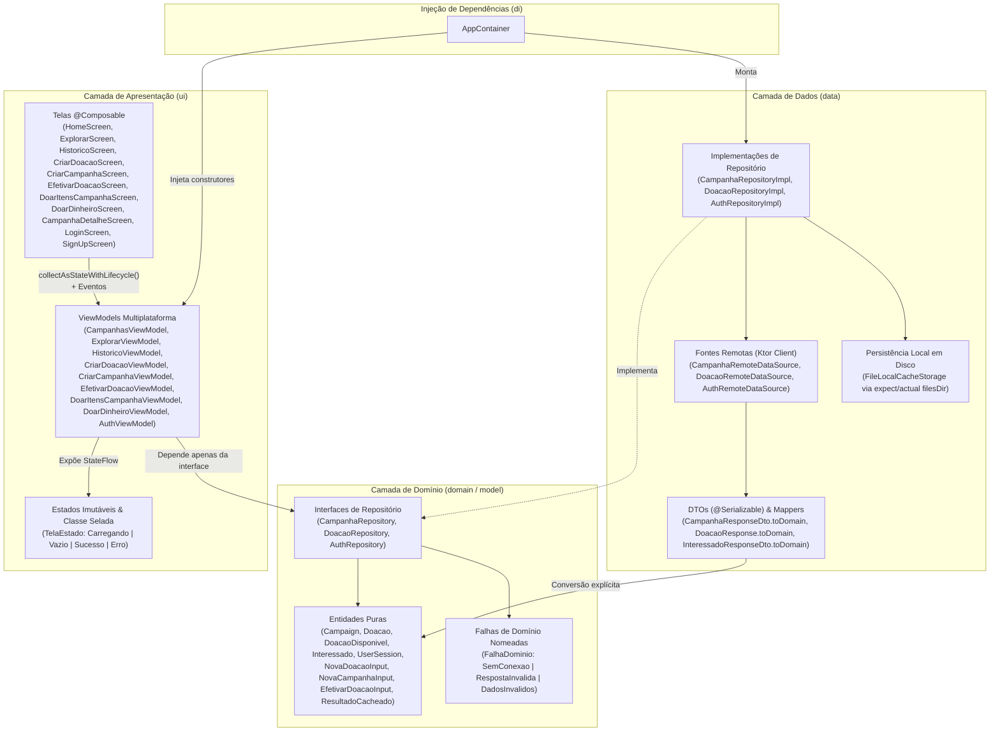
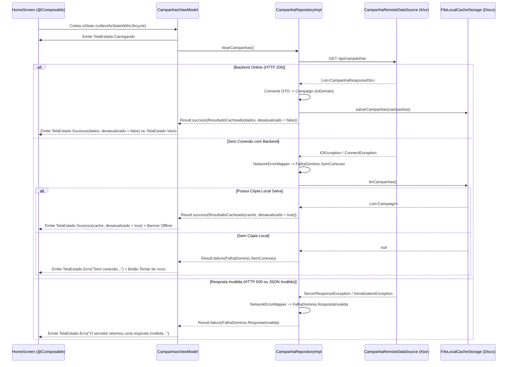

# Arquitetura do Aplicativo — Solidar.io (KMP & Compose Multiplatform)

Este documento descreve a arquitetura em camadas adotada no módulo compartilhado (`app/shared/src/commonMain`) do **Solidar.io**, o fluxo de dados entre o backend Spring Boot, o cache local e a interface Jetpack Compose, bem como as justificativas de projeto para gerenciamento de estado e persistência local.

---

## 1. Diagrama das Camadas

O código comum (`commonMain`) está organizado em três camadas com dependências unidirecionais apontando para o **Domínio**:

### Regras de Isolamento
1. **Domínio (`domain`):** Não importa Compose, Ktor Client, DataStore, Koin nem conhece os DTOs da camada `data`. Declara apenas entidades de negócio, interfaces de repositório e a hierarquia selada `FalhaDominio`.
2. **Dados (`data`):** Implementa as interfaces do domínio, configura o Ktor Client com `expectSuccess = true`, `ignoreUnknownKeys = true` e `coerceInputValues = true`, realiza a conversão explícita de DTOs para entidades do domínio (`toDomain()`), traduz exceções técnicas em `FalhaDominio` (`NetworkErrorMapper`) e gerencia a cópia local em disco (`FileLocalCacheStorage`), isolando preferências por conta (`userId`).
3. **Apresentação (`ui`):** Cada tela com dados possui um `ViewModel` multiplataforma que recebe seu repositório pelo construtor via `AppContainer`, expõe um `StateFlow` imutável e é observado pela tela com `collectAsStateWithLifecycle()`.

---

## 2. Caminho de um Dado do Backend até a Tela

---

## 3. Justificativa do Gerenciamento de Estado (`ViewModel` + `StateFlow` + `TelaEstado`)

* **Sobrevivência a mudanças de configuração e ciclo de vida:** O uso de `androidx.lifecycle.ViewModel` multiplataforma combinado com `collectAsStateWithLifecycle()` garante que o estado das telas (listas carregadas, abas selecionadas, favoritos e campos de formulário em preenchimento) sobreviva a rotações de tela no Android e pause a coleta quando a interface vai para segundo plano.
* **Previsibilidade com `StateFlow` imutável e Classe Selada (`TelaEstado`):** Expor um único `StateFlow` de uma `data class` imutável contendo a classe selada `TelaEstado` (`Carregando`, `Vazio`, `Sucesso`, `Erro`) impede estados inconsistentes (como exibir simultaneamente indicador de carregamento e mensagem de lista vazia) e obriga a interface a tratar todos os cenários possíveis em um `when` exaustivo sem `else`.
* **Testabilidade determinística:** Como nenhuma função `@Composable` guarda estado de negócio em `remember` e os ViewModels recebem interfaces de repositório pelo construtor, toda a máquina de estados é testada em milissegundos na JVM usando `kotlinx-coroutines-test` (`StandardTestDispatcher`) e `Turbine`.

---

## 4. Justificativa da Persistência Local (`FileLocalCacheStorage` com `expect`/`actual`)

* **Escolha técnica:** Optou-se pela persistência local estruturada em arquivos JSON no diretório nativo de arquivos de cada plataforma (`context.filesDir` no Android, diretório de usuário `~/.solidario_cache` no Desktop/JVM e `NSUserDefaults`/`NSDocumentDirectory` no iOS), obtido via funções `expect`/`actual` (`platformStorageDir`, `readPlatformFileText` e `writePlatformFileText`), utilizando `kotlinx.serialization`.
* **Por que essa abordagem para o MVP:**
  1. **Zero sobrecarga de geração de código nativo:** Como os payloads de campanhas, doações disponíveis, histórico de doações, quantidades doadas por item e IDs de favoritos/interesses (isolados por `userId`) já são coleções estruturadas consumidas via `kotlinx.serialization`, a gravação atômica em arquivos JSON na pasta `filesDir` do dispositivo persiste os dados entre fechamentos do app sem exigir schemas SQL complexos.
  2. **Suporte completo a todos os alvos KMP (Android, Desktop JVM e iOS):** Funciona de forma uniforme nos três alvos configurados no projeto e permite injeção direta de leitores/escritores em memória nos testes automatizados (`RepositoryAndCacheTest` e `ExplorarECriarCampanhaTest`).
  3. **Experiência Offline Transparente:** A cada resposta bem-sucedida do backend, a cópia local é atualizada (incluindo campanhas e doações disponíveis). Quando o dispositivo abre o aplicativo sem rede, o repositório recupera imediatamente os dados persistidos com `desatualizado = true`, permitindo que a tela exiba o conteúdo acompanhado do banner de aviso de modo offline.

---

## 5. Principais Fluxos e Endpoints Integrados

| Fluxo | Telas / ViewModels | Endpoints REST |
| :--- | :--- | :--- |
| **Feed de Campanhas & Favoritos** | `HomeScreen`, `CampanhaDetalheScreen`, `CampanhasViewModel` | `GET /api/campanhas` |
| **Criação e Gestão de Campanhas** | `CriarCampanhaScreen`, `CriarCampanhaViewModel`, `HistoricoScreen` (aba `Campanhas`), `CampanhaDetalheScreen` | `POST /api/campanhas`, `GET /api/campanhas/minhas`, `PUT /api/campanhas/{id}/finalizar`, `PUT /api/campanhas/{id}/cancelar` |
| **Doação em Campanha (Itens e PIX)** | `OpcoesDoacaoScreen`, `DoarItensCampanhaScreen`, `DoarDinheiroScreen` | `POST /api/doacoes` |
| **Feed de Doações Disponíveis e Interesse** | `ExplorarScreen`, `HomeScreen` (aba `Oferecem doações`), `ExplorarViewModel` | `GET /api/doacoes/disponiveis`, `POST /api/doacoes/{id}/interesse`, `DELETE /api/doacoes/{id}/interesse` |
| **Efetivação e Histórico de Doações** | `HistoricoScreen` (`Feitas`, `Interessados`, `Recebidas`, `Campanhas`), `EfetivarDoacaoScreen`, `HistoricoViewModel`, `EfetivarDoacaoViewModel` | `GET /api/doacoes/minhas`, `GET /api/doacoes/recebidas`, `GET /api/doacoes/{id}/interessados`, `PUT /api/doacoes/{id}/efetivar`, `DELETE /api/doacoes/{id}` |
